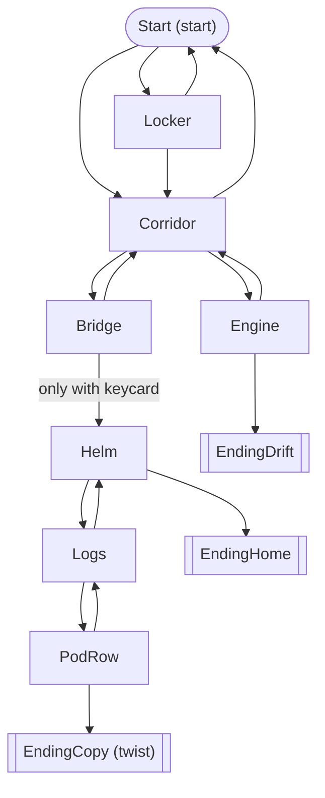
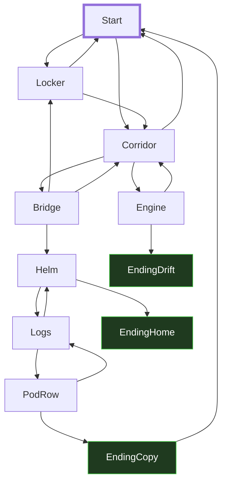

# Story Brief — M3A

- Your name: Abdullah
- Story title: Cryo Wake
- Route Twee (Twee 3, Harlowe 3). I chose this route because of E-05: my player will play in a browser through Twine.

---

## 1. Player evidence

No other player was available, so I used the **No player** route (Prompt 2N in `coda-prompts.md`). An AI helper asked me the questions, and I answered as the player.

- Player name: Abdullah (answering as the player, Prompt 2N)

| ID | Question | Their answer |
|---|---|---|
| E-01 | What kind of stories do you like? | Sci-fi / space. |
| E-02 | How many minutes do you want to play? | About 2–3 minutes. |
| E-03 | What do you not like in a story game? | Getting stuck or lost. |
| E-04 | How do you want it to end? | A twist ending. |
| E-05 | Where will you play (phone, laptop, terminal)? | In a browser (Twine). |
| E-06 | Do you like picking up an item early that you need later? | Yes, I like that. |

---

## 2. User stories

| ID | User story | Evidence |
|---|---|---|
| US1 | As a sci-fi fan, I want the story to take place on a spaceship, so that it is the kind of story I already choose to read. | E-01 |
| US2 | As a player with 2–3 minutes, I want to be able to reach an ending in 4 choices or fewer, so that I can finish a full run in one short break. | E-02 |
| US3 | As a player who hates getting stuck, I want every passage that is not an ending to have at least one link I can click, so that I never end up on a page with nothing to do. | E-03 |
| US4 | As a player who wants a twist, I want one ending that shows me something no earlier passage told me, so that the ending surprises me. | E-04 |
| US5 | As a player who likes items, I want to pick up an item early that opens something later, so that my early choice pays off. | E-06 |
| US6 | As a player who plays in a browser, I want the story to open and play in Twine, so that I can play it where I said I would. | E-05 |

---

## 3. Acceptance checks

| Story | Check | Pass / Fail (fill in after you build) |
|---|---|---|
| US1 | The first passage (Start) uses the word "ship" or "starship" and the word "space" or "stars". | Pass: Start says "starship Meridian" and "far out in space among the stars". |
| US2 | From Start I can reach at least one ending in 4 clicks or fewer (I count the clicks). | Pass: Start → Corridor → Engine → EndingDrift is 3 clicks. EndingHome is 5 clicks. |
| US3 | On my play-throughs I count passages that have no link and are not an ending. The count is 0. `story_check.py` shows 0 dead ends and 0 traps. | Pass: count is 0, and the checker shows no findings. |
| US4 | The twist ending says I am a copy. I search the text of every other passage: none of them says that. | Pass: "copy" appears only in EndingCopy (and in one link target name, which the player never sees). |
| US5 | With the keycard, the Bridge passage shows a "Swipe your keycard" link. Without it, that link is not there. | Pass: without the card the links are "Go to your locker" and "Go back to the corridor". With the card they are "Swipe your keycard" and "Go back to the corridor". |
| US6 | Twine imports `cryo_wake.twee` with no error and shows the map. Build → Play opens the Start passage in the browser. | Pass: built with Harlowe 3.3.9 (`cryo_wake.html`) and played in a browser with 0 errors. **[Still to do: import into the Twine app once and confirm the map shows.]** |

---

## 4. Budget and cut list

Budget: **8 to 12 passages.** My plan uses **11** (8 passages + 3 endings).

**Keep** (in order of value to my player)

| Order | Story | Why it is first (or next) |
|---|---|---|
| 1 | US3 (never stuck) | E-03 is the one thing my player said they do not like. A stuck player quits, and then no other story matters. |
| 2 | US2 (ending in 4 choices or fewer) | E-02: 2–3 minutes is a hard limit. If the story is too long, the player does not finish. |
| 3 | US1 (spaceship) | E-01: the setting is why they would start the story at all. It costs no extra passages. |
| 4 | US4 (twist ending) | E-04: this is how they want it to end. It costs 1 ending and 1 passage (Pod Row). |
| 5 | US5 (item used later) | E-06: costs 1 passage (Locker) and one `(if:)`. |
| 6 | US6 (plays in Twine) | E-05: the route choice (Twee) covers it, so it costs no passages. |

**Cut list**

| Story | Why it waits | What would bring it back |
|---|---|---|
| US7: As a player who likes twists, I want three different twist endings, so that each replay surprises me in a new way. (E-04) | Each twist needs its own lead-up passage plus an ending. That is 4 more passages, and the plan would be 15, over the budget of 12. | If the budget goes up to 15 passages, or if I drop the Engine branch (2 passages) and the playtest shows the player does not miss it. |
| US8: As a player who hates getting lost, I want a status line at the top of each passage that shows where I am and what I carry, so that I always know my place. (E-03) | US3 already covers "stuck". A status line needs a `[header]` passage and a variable for every room. That is more work than the budget allows, and the evidence is weaker: the player said "stuck or lost", not "I need a status line". | If my player stops or looks lost during the playtest (part 8) even though every passage has a link. |

---

## 5. Story map (plan, version 1, before part 6)

Start passage: **Start**. Endings: **EndingHome**, **EndingDrift**, **EndingCopy**.

| Passage name | What happens | Links to |
|---|---|---|
| Start | You wake in pod 7 in the cryo bay of the starship Meridian. Alarms. | Locker, Corridor |
| Locker | Your crew locker. You take your bridge keycard ($hasCard). | Corridor, Start |
| Corridor | A junction: bridge one way, engine room the other. | Bridge, Engine, Start |
| Bridge | The bridge door. It opens only with a keycard. | Helm (only with keycard), Corridor |
| Helm | The ship AI, VESTA, welcomes you back. | Logs, EndingHome |
| Logs | The ship's log says the date has been reset many times. | PodRow, Helm |
| PodRow | A row of sealed pods. One has your name on it. | EndingCopy, Logs |
| Engine | The reactor is leaking. | EndingDrift, Corridor |
| EndingHome | You order VESTA to fly home. (good ending) | — |
| EndingDrift | You vent the reactor. The ship goes dark and drifts. (bad ending) | — |
| EndingCopy | You open your own pod. You are inside it, asleep. You are a copy. (twist ending) | — |

---

## Planning gate

I read parts 1 to 5 as the player and said: "Yes, I'd play it."

- [x] My player said yes. (No player: I said yes.)
- [x] Every user story has evidence and an acceptance check.
- [x] My map has a start and at least 2 endings.

---

## 6. Ask before you build

**My question:** If my player goes to the Bridge without the keycard, are they stuck? And if they take the card and then go back to their pod, do they still have it?

**Evidence I used:** the state table below and my part 5 map (I traced the arrows out of Bridge by hand).

| What it is | Where it changes | Where it is read |
|---|---|---|
| `$hasCard` (the bridge keycard) | Set to `false` once in `Setup [startup]`, before the story starts. Set to `true` in `Locker`. Nothing sets it back to `false`. | `Bridge`: `(if: $hasCard is true)` shows "Swipe your keycard". `(else:)` shows text that says where the card is. |

**What the evidence showed:**
1. The card is not lost when the player goes back. `Setup` runs only once, and `Start` never resets the card.
2. Bridge is not a dead end without the card, because it still has "Go back to the corridor". But in plan v1 the player only reads "the door is shut" and has to guess that the card is in the locker, which is two passages away. That is the "getting lost" my player told me about (E-03).

**Decision:** Revise.

**One sentence why:** The map showed that a player at the Bridge without a card has a way out but no clue where to go (E-03), so I changed the plan: the `(else:)` text now says where the card is, and I added a new link from Bridge straight to Locker.

---

## 7. Where each job lives

- **Shows text** (print and input): Harlowe does this job. It shows the text of the current passage in the browser and turns each `[[text->Target]]` into a link the player clicks; my `.twee` file has no print or input code.
- **Applies rules** (decides what happens next): the `[[...->Target]]` links in every passage choose the next passage, and three lines change the rules: `(set: $hasCard to false)` in `Setup`, `(set: $hasCard to true)` in `Locker`, and the `(if: $hasCard is true)[...](else:)[...]` line in `Bridge`.
- **Holds the story** (the passage words): the plain text under each `:: Name` heading in `cryo_wake.twee`, from `:: Start` to `:: EndingCopy`.

---

## 8. Decision after the playtest

- `story_check.py` findings left: 0 ("OK: no orphans, no dead ends, no broken links, no traps."). 11 passages, 3 endings, 19 links.
- Acceptance checks passed: 6 of 6 (see part 3; US6 still needs one import into the Twine app).
- Where my player stopped or looked confused: **[I stopped at "The corridor splits. A sign points left to the BRIDGE. A hot smell comes from the right, where the ENGINE ROOM is" because everything after that point was pivotal to the story ]**

**Decision** (Accept / Revise): **[Accept]**

**Evidence:** The checker shows 0 findings, so the map works. All 6 acceptance checks pass on browser play-throughs of six paths: the shortest ending in 3 clicks, the Bridge with and without the card, getting the card after visiting the Bridge, keeping the card after going back, and the twist ending followed by "Begin again". **[I tried the whole thing,so I have 2 deaths and 4 good endings]**

---

## Hooks done

- **H1 State:** `$hasCard` changes what the player can do at the Bridge. The part 6 table shows where it changes and where it is read.
- **H3 Plan vs built:** below.

## H3 Plan vs built

Part 5 (plan v1) is above. This is the map from `python story_check.py cryo_wake.twee --map`:

What changed: the built map has two arrows the plan did not have. **Bridge → Locker** comes from my part 6 decision: a player with no card gets a clue and a direct link, so they do not get lost (E-03). **EndingCopy → Start** ("Begin again") came while building: the twist says VESTA wakes a new copy each time, so starting over is part of the story, and it is also the Twee link that goes back to an earlier passage. The checker still counts EndingCopy as an ending because its name starts with `Ending`.

## H6 Playtest log (optional, not claimed)

| Where did the player stop or get confused? | What I changed (or why I did not) |
|---|---|
| | |
